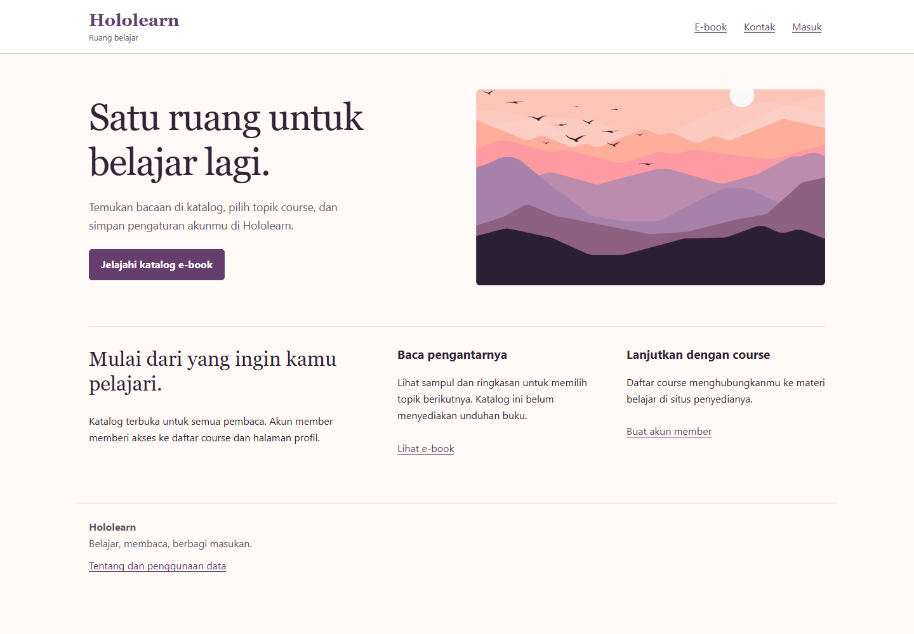
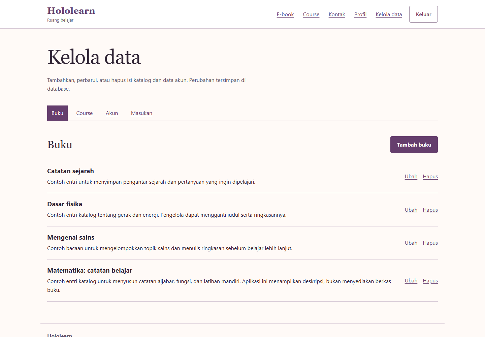

# Hololearn

Katalog belajar berbasis Java Servlet, JSP, dan JDBC. Pengunjung dapat membaca ringkasan e-book dan mengirim masukan. Member mempunyai profil dan akses ke tautan course. Admin mengelola buku, course, akun, serta masukan dari database MySQL.

Versi ini melanjutkan aplikasi **ServletLogin** dari folder Hololearn lama. Nama, warna plum, ilustrasi pegunungan, dan sebagian sampul dipertahankan. Struktur Eclipse dan koneksi database yang bergantung komputer lama diganti dengan Maven WAR serta Docker Compose.



*Tangkapan demo lokal pada 25 Oktober 2026 dengan data contoh sintetis.*

<details>
<summary>Lihat pengelolaan katalog buku</summary>



*Daftar buku contoh pada halaman Kelola data.*

</details>

## Jalankan dengan Docker

Siapkan Docker Desktop dengan Linux containers dan Docker Compose. Java, Maven, dan MySQL tidak perlu dipasang di Windows untuk cara ini.

Mulai dari direktori repo:

```powershell
git clone https://github.com/zalamanga/hololearn.git
cd hololearn
```

1. Salin `.env.example` menjadi `.env`:

   ```powershell
   Copy-Item .env.example .env
   ```

2. Buka `.env`, lalu isi `DB_PASSWORD`, `DB_ROOT_PASSWORD`, dan `ADMIN_PASSWORD` dengan nilai berbeda. Kata sandi admin harus 12 sampai 128 karakter. `ADMIN_EMAIL` merupakan email login admin awal; gunakan alamat contoh untuk demo lokal. Jangan commit `.env`.

3. Bangun dan jalankan:

   ```powershell
   docker compose up --build -d
   docker compose ps
   ```

4. Setelah layanan sehat, buka **http://127.0.0.1:18095**. Masuk menggunakan email dan kata sandi admin yang kamu isi pada `.env`. Untuk mencoba member, pilih Masuk lalu Daftar sebagai member.

Unduhan image/dependensi pertama memerlukan internet. `APP_PORT` dapat diubah jika 18095 sudah dipakai. Port aplikasi hanya dipublikasikan pada loopback; port MySQL tidak dipublikasikan ke host.

```powershell
docker compose logs --tail 80 app
docker compose stop
docker compose start
```

Data tersimpan pada volume `database`. `docker compose down` menghapus container/jaringan proyek dan mempertahankan volume. Schema serta entri contoh hanya dimasukkan ketika volume baru pertama kali dibuat. Mengubah file schema tidak menimpa database yang sudah ada. Mengganti `ADMIN_PASSWORD` pada `.env` juga tidak mengganti akun yang sudah dibuat; gunakan Profil atau Kelola data untuk mengubah kata sandinya.

## Alur yang tersedia

| Pengguna | Tindakan |
| --- | --- |
| Pengunjung | Membuka beranda dan katalog e-book, mengirim masukan, mendaftar, masuk |
| Member | Membuka tautan course, mengubah nama/email, mengganti kata sandi dengan kata sandi saat ini, keluar |
| Admin | Semua alur member; menambah, membaca, mengubah, dan menghapus buku, course, akun, serta masukan |

Penghapusan mempunyai halaman konfirmasi. Admin terakhir tidak dapat dihapus atau diturunkan perannya. Peran pengguna dibaca ulang dari database pada setiap permintaan aplikasi agar perubahan hak akses berlaku pada sesi yang sudah masuk. Cookie sesi bernama `HOLOLEARN_SESSION` agar tidak bertabrakan dengan aplikasi Java lain pada localhost.

Katalog menampilkan sampul dan deskripsi, **tidak menyediakan unduhan buku**. Course mengarah ke URL http/https penyedia materi. Form kontak menyimpan pesan di database, tidak mengirim email. Tidak ada pembayaran, sertifikat, unggahan berkas, atau pengiriman email pemulihan kata sandi.

## Build dan pengujian

Dockerfile menjalankan `mvn clean verify` sebelum menyalin WAR ke Tomcat. Untuk membangun tanpa Docker, siapkan **JDK 17 dan Maven 3.9**:

```powershell
mvn -B -ntp clean verify
```

Hasilnya `target/hololearn.war`. Tes JUnit menguji hashing kata sandi dan validasi input, tidak mengakses database. Untuk menjalankan WAR secara manual, gunakan Tomcat 9, siapkan MySQL 8.4 dengan schema `database/schema.sql`, lalu berikan variabel environment berikut pada proses Tomcat:

| Variabel | Isi |
| --- | --- |
| `DB_HOST` / `DB_PORT` | Host MySQL dan port, default `127.0.0.1` / `3306` |
| `DB_NAME` / `DB_USER` | Nama database dan pengguna, default `hololearn` |
| `DB_PASSWORD` | Kata sandi database, wajib |
| `ADMIN_EMAIL` / `ADMIN_PASSWORD` | Akun admin pertama jika database belum mempunyai admin |

Tomcat tidak membaca `.env` secara otomatis. Untuk URL yang sama seperti Docker, deploy WAR sebagai `ROOT.war`; nama WAR lain menambah context path. Tomcat 10/11 memakai namespace Jakarta dan bukan target aplikasi `javax.servlet` ini. [Dokumentasi Tomcat 9](https://tomcat.apache.org/tomcat-9.0-doc/index.html).

## Struktur

```text
database/schema.sql                 schema dan data contoh sintetis
src/main/java/id/hololearn/          servlet, repository, validasi, sesi, hashing
src/main/webapp/WEB-INF/views/       JSP yang hanya diakses melalui servlet
src/main/webapp/assets/              CSS, JavaScript, enam aset sumber
src/test/java/id/hololearn/          tes JUnit tanpa database
Dockerfile                          build Maven dan runtime Tomcat
compose.yaml                        aplikasi dan MySQL
```

`/health` memeriksa koneksi database dan mengembalikan 200 atau 503. Gunakan endpoint ini untuk memeriksa kesiapan, bukan sebagai halaman pengguna.

## Batas penggunaan dan perubahan teknis

Ini aplikasi latihan untuk dijalankan lokal. Gunakan data contoh. Antarmuka Tentang menjelaskan data yang disimpan dan siapa yang dapat mengelolanya. Penerapan untuk pengguna publik masih memerlukan HTTPS, konfigurasi cookie Secure pada reverse proxy, pembatasan percobaan login, kebijakan retensi/backup, pemantauan, dan peninjauan operasional.

Versi lama menggunakan beberapa route login, kata sandi mentah, state JDBC statis, dan JSP yang langsung mengubah database melalui tautan GET. Versi ini memakai satu alur login, PBKDF2-HMAC-SHA256 dengan salt acak dan 600.000 iterasi, token CSRF untuk POST, validasi server, pemeriksaan peran, prepared statement, serta penutupan resource JDBC. Tidak ada migrasi otomatis kata sandi/data lama. Koneksi database Docker memakai jaringan lokal tanpa TLS; jangan menggunakan konfigurasi tersebut untuk database jarak jauh.

## Asal sumber dan aset

Halaman Hololearn asli mencantumkan kredit [Ifarra](https://github.com/Ifarra). Sumber lokal yang dilanjutkan bernama `Hololearn-servlet-main/ServletLogin`; tidak ditemukan remote Git atau berkas lisensi pada sumber yang diperiksa. Pembersihan ini tidak membuktikan kepemilikan seluruh kode dan aset, serta tidak menambahkan klaim lisensi baru.

Enam aset pada folder `assets` disalin tanpa perubahan dari sumber: `parabg.png`, `Math.webp`, `Science.webp`, `Physics.webp`, `History1.jpeg`, dan `favicon-32x32.png`. Judul/deskripsi katalog awal adalah contoh baru, bukan data pribadi atau hasil ekspor database lama. Lihat [NOTICE](NOTICE) untuk catatan atribusi.
