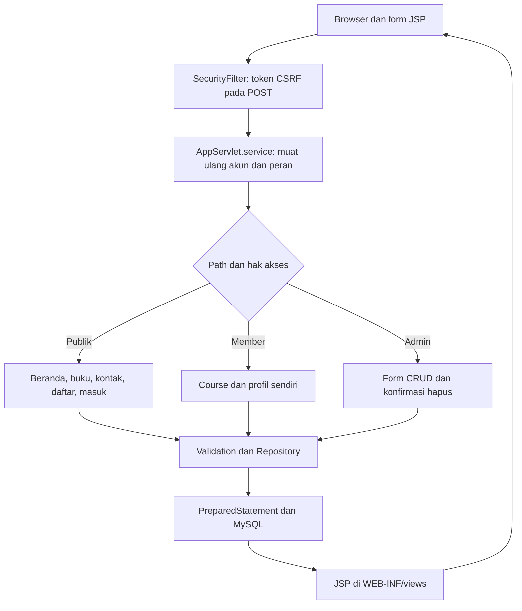

# Alur kode Hololearn

Hololearn memakai Servlet/JSP dan JDBC MySQL. Pengunjung membaca ringkasan e-book atau menyimpan masukan. Akun member memperoleh profil serta tautan course; admin mengelola buku, course, akun, dan masukan. Katalog bukan layanan unduhan buku, dan form kontak tidak mengirim email.

## Pemetaan request dan akun

[`AppServlet`](../src/main/java/id/hololearn/AppServlet.java) dipetakan ke `/`. Aset diteruskan ke default servlet Tomcat; `/health` hanya memeriksa koneksi. Request aplikasi lainnya memanggil `current()` untuk mengambil ulang akun dari database berdasarkan `accountId` sesi. Akun yang dihapus tidak lagi dianggap login; perubahan peran berlaku pada request berikutnya.

`service()` mewajibkan login untuk `/courses`, `/profile`, dan path `/admin`; path admin juga memerlukan `isAdmin()`. `doGet()` memilih halaman JSP dan menyiapkan data. View berada di `WEB-INF/views`, sehingga pengguna mengakses controller, bukan membuka JSP secara langsung.

`doPost()` memproses registrasi, login, keluar, profil, kontak, dan perubahan admin. Registrasi selalu membuat peran `user`. `Repository.authenticate()` memverifikasi hash melalui `Passwords`. `signIn()` membatalkan sesi lama dan membuat sesi baru dengan `accountId`; logout membatalkan sesi tersebut. Password baru pada profil memerlukan password saat ini, lalu mengganti ID sesi dan token CSRF.

[`SecurityFilter`](../src/main/java/id/hololearn/SecurityFilter.java) menyiapkan token CSRF sesi dan atribut form. POST tanpa token cocok mendapat 403. Pemeriksaan peran tetap berada di controller; token CSRF sendiri bukan izin admin.

## Data publik, member, dan admin

[`Repository.entries()`](../src/main/java/id/hololearn/Repository.java) memilih query dari jenis yang diizinkan oleh [`Validation`](../src/main/java/id/hololearn/Validation.java). Nama tabel tidak diambil bebas dari input. `books` berisi judul/deskripsi/sampul; `courses` berisi judul/topik/URL; `feedback` berisi nama/masukan/email. Nilai query menggunakan prepared statement.

Form [`edit.jsp`](../src/main/webapp/WEB-INF/views/edit.jsp) mengirim POST `/admin/save`, termasuk jenis, ID, serta token CSRF. ID nol berarti data baru; ID positif berarti update. Penghapusan diawali halaman konfirmasi, kemudian POST `/admin/delete`. Course hanya membuka URL http/https yang telah divalidasi, seperti terlihat pada [`courses.jsp`](../src/main/webapp/WEB-INF/views/courses.jsp).

Admin mempunyai akses pada seluruh data kelolaan. Profil member dibatasi ke ID akun dari sesi, bukan ID kiriman form. Masukan kontak masuk ke tabel `feedback`; tidak ada pengiriman SMTP.

## Transaksi dan batas persistensi

`Database.open()` membuka koneksi dari environment untuk setiap operasi. Resource JDBC ditutup oleh try-with-resources. Penambahan/perubahan entri dan profil menggunakan statement tersendiri dengan autocommit; aplikasi tidak mempunyai versi record untuk mencegah dua editor menimpa perubahan katalog.

Perubahan akun yang sudah ada serta penghapusan memakai transaksi eksplisit. `guardLastAdmin()` mengunci daftar admin dengan `FOR UPDATE` sebelum mengizinkan penghapusan atau penurunan peran, sehingga admin terakhir dipertahankan. Jaminan ini khusus alur tersebut, bukan mekanisme versi bagi seluruh data.

[`Bootstrap`](../src/main/java/id/hololearn/Bootstrap.java) membuat admin dari environment hanya jika belum ada admin. Schema/entri contoh berasal dari [`database/schema.sql`](../database/schema.sql); tidak ada migrasi otomatis data lama. Kesalahan input diarahkan ke form dengan status 400; query gagal menghasilkan halaman 503 tanpa mencetak parameter sensitif. Setelah koneksi gagal saat menulis, periksa daftar sebelum mengirim ulang: tidak ada kunci deduplikasi permintaan atau pengulangan tulis otomatis.
